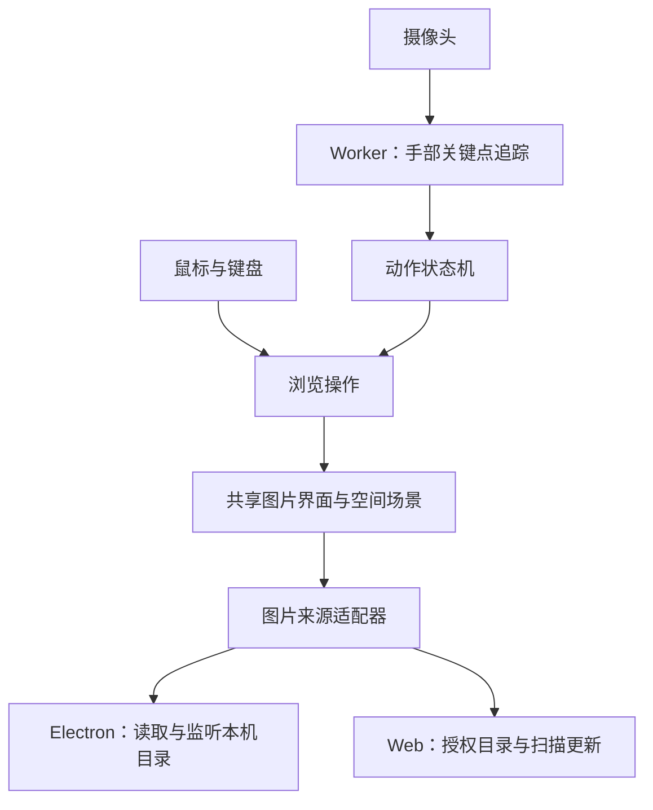

# AirGallery 技术方案草案

- 日期：2026-11-04
- 最近更新：2026-11-05
- 状态：已按下述组合搭建 v0.1 原型；Chrome 与 macOS 验证范围、尚未验证的平台和性能项见[实现状态](./IMPLEMENTATION_STATUS.md)。
- 需求依据：[产品需求主文档](./PRODUCT_REQUIREMENTS.md)、[立项草案](./PROJECT_BRIEF.md)。本文保留方案与取舍过程；当前实现以代码和实现状态文档为准，产品交互以主文档为准。

## 1. 推荐组合

| 部分 | 建议 | 用途 |
| --- | --- | --- |
| 共享界面 | React + TypeScript + Vite | 设置、图片墙、单图查看和交互状态 |
| 空间展示 | Three.js + React Three Fiber | 悬浮照片墙、纵深排列与视角过渡 |
| 普通控件 | HTML/CSS | 设置、提示、键盘焦点和文字控件 |
| 手部追踪 | MediaPipe Hand Landmarker | 从摄像头画面提取手部关键点 |
| 手势解释 | TypeScript 动作状态机 | 根据关键点随时间的变化判断挥手、捏合、缩放 |
| 桌面应用 | Electron | macOS、Windows 安装包与本机文件访问 |
| Web 本机目录 | File System Access API | 用户选择并授权后读取当前电脑上的目录 |
| 配置与缓存 | Web 使用 IndexedDB；桌面使用应用数据目录 | 记住目录、浏览状态，保存必要的缩略图缓存 |

原型已采用上述组合，无业务后端；Web 发布需提供静态页面和模型资源。兼容性、真实手势准确率与规模化性能仍需持续验证。

## 2. 共享边界

图片浏览、手势解释和视觉效果共用；文件读取与目录更新通过平台适配器实现。

操作统一为选择画册、打开／退出画册、组内翻页、空间缩放与平移、单图缩放与平移、恢复总览。空间和单图维护独立视图状态，操作明确携带作用域；手势与鼠标调用相同操作，避免两套浏览逻辑。高频追踪坐标与动画不通过每帧 React 状态更新传递。

## 3. 桌面端建议优先 Electron

Electron 基于 Chromium，主进程可使用 Node.js 与操作系统交互；文件访问通过受限的 preload/IPC 接口提供给界面。目录访问限制在用户选定的目录内，不向渲染页面暴露任意文件系统访问。

Tauri 仍是候选。它在 Windows 使用 WebView2，在 macOS 使用 WKWebView，因此摄像头、模型推理与渲染组合需分别验证。本项目优先考虑运行环境一致性，暂推荐 Electron；安装包和内存占用是需要测量的代价。

依据：[Electron 进程模型](https://www.electronjs.org/docs/latest/tutorial/process-model)、[Tauri WebView 说明](https://v2.tauri.app/reference/webview-versions/)。这里关于工程取舍的结论是本项目的判断。

## 4. 目录自动加载

- 桌面端：选择目录，后台扫描并建立索引；监听文件变化并合并短时间内的事件，变更后局部更新。目录监听异常时允许手动重扫。
- Web：建议首版以当前桌面 Chrome、Edge 为目标，启动时检测目录 API 支持情况；浏览器最低版本待实测确认。不支持时明确提示使用支持的浏览器或桌面应用。
- Web 将目录句柄保存在 IndexedDB；再次启动时检查权限，必要时由用户点击重新授权。
- Web 首版采用有界、可暂停的定期扫描，辅以窗口重新获得焦点时扫描和手动刷新；扫描间隔按图片数量和实测耗时调整，避免承诺原生监听效果。
- 原图按需读取；照片墙使用缩略图，单图打开后再加载较高分辨率版本。限制解码并发和纹理缓存，离开画面后及时释放。
- 图片索引需包含分组、组内有序图片与首张封面。是否按子目录划分组、组内排序、首版图片数量上限仍待讨论。图片修改也应触发缓存失效。

目录句柄可序列化至 IndexedDB，但保存句柄不等于始终保有访问权限。依据：[Chrome File System Access 官方文档](https://developer.chrome.com/docs/capabilities/web-apis/file-system-access)。

## 5. 手势控制

使用现成手部关键点模型，不计划在首版训练自有模型。模型给出手部位置；切图、翻页等动态操作由应用根据轨迹和当前浏览状态判断。

建议原型比较以下动作：

| 动作 | 浏览行为 | 冲突处理 |
| --- | --- | --- |
| 张开手掌后横向挥动 | 候选为空间焦点切换或组内翻页 | 按当前模式触发一个动作；动作结束后才可再次触发；空间导航映射待确定 |
| 双手各自捏合并拉开／靠近 | 空间模式连续缩放整个空间，组内模式缩放当前图 | 双手锁定期间暂停切图；缩放相对本次起始间距及当前尺度计算 |
| 单手捏合拖动 | 空间平移或查看已放大图片局部 | 与挥手互斥；缩放结束后先释放捏合，再进入单手拖动 |
| 单手比 V / 握拳并保持约 600ms | V 打开中心选中画册；握拳退出组内查看 | 仅在对应模式生效，显示进度；双手、改姿势、丢手、过大移动或长停顿取消；同姿势保持不连发 |
| 单手持续竖拇指 | 首页与照片页持续生成随机夸奖雨 | 检查四指弯曲、拇指伸直且向上；与握拳互斥，以持续识别状态驱动，丢手或识别超时停止新增 |
| 屏幕按钮／快捷键 | 重置视图、暂停识别 | 首版保持明确入口，额外手势待验证 |

双手缩放有较直观的距离映射，也更依赖视野和双手追踪；是否采用取决于近距离与远距离实测。丢手时退出当前动作并保留画面，重新识别后重新建立起点。阈值按手掌尺寸归一化，并使用平滑、进入／退出阈值和冷却避免抖动。

MediaPipe 检测方法同步执行，官方建议用 Worker 避免阻塞界面。本项目计划单独运行识别、丢弃过期帧，避免图像队列持续增长；Worker 中的推理后端与图像传输方式在原型中验证。模型和 WASM 随应用资源部署，摄像头画面仅在本机处理。

依据：[MediaPipe Web Hand Landmarker 官方指南](https://developers.google.com/edge/mediapipe/solutions/vision/hand_landmarker/web_js)。

夸奖雨以摄像头持续识别状态驱动，每 320ms 分批随机补充文字；CSS transform / opacity 完成下落，无逐帧 React 更新。过期节点按批回收，标准模式最多 160 条；减少动态效果时最多 12 张静态卡片，每约 2 秒随机刷新。有效识别结果超过 350ms 未更新时停止新增，过期结果不续期。松手后让当前文字落完，打开设置、隐藏页面或卸载时清理定时器与事件监听。P 键预览有限发射约 3.5 秒，再等待已有文字落完。

## 6. 视觉建议

### 6.1 背景玻璃材质

最新确认的背景为偏苹果风格的半透明磨砂玻璃，替代旧版近黑不透明底。将系统／页面背景、玻璃层、照片渲染层及文字界面分开；照片渲染层应允许底层材质透出，不能被不透明画布清屏遮住，也不能对照片层整体套模糊。

候选平台方案：macOS 评估 Electron `vibrancy`；Windows 评估系统 `backgroundMaterial`。Electron 文档标注该 Windows 方法支持 Windows 11 22H2 及以上，旧系统需单独降级。两者均不直接等同于 Apple 原生 Liquid Glass，需验证窗口状态、全屏、透明渲染及性能。[Electron 官方窗口文档](https://www.electronjs.org/docs/latest/api/base-window)

Web 候选为页面内可控背景配合半透明色层及 `backdrop-filter`；该滤镜作用于元素后方内容，不能将其描述为网页获得系统桌面透底能力。需验证玻璃层和画布的合成顺序，避免模糊到前景照片。[MDN 官方说明](https://developer.mozilla.org/en-US/docs/Web/CSS/Reference/Properties/backdrop-filter)

背景合成保持屏幕空间稳定，照片空间单独缩放和平移；校准模糊、对比度及透明度，并验证减少透明度／低性能降级。参考 [Apple 材质设计](https://developer.apple.com/design/human-interface-guidelines/materials)，只将其作为视觉目标，不承诺三端逐像素相同。具体实现尚未实测。

### 6.2 主题配置与切换

首版主题建议及产品规则以产品主文档 6.5 为准。将主题配置独立于图片索引、空间视图和手势状态；主题切换只更新背景材质及界面配色，不重建画册布局、不重扫目录、不重启摄像头。

建议主题配置包含稳定主题 ID、显示名、明暗分类、背景配色、模糊／透明度参考、名称字色及控件配色，并为系统材质不可用时提供替代参数。预置配置和必要的背景素材随应用提供，Web 可使用本地生成渐变；主题颜色作为系统材质的综合色目标，避免承诺原生透底完全服从固定色值。

分别维护已应用偏好和临时预览。用户应用后持久化固定主题 ID 或跟随系统模式；取消及关闭未应用预览时撤销。跟随模式解析出的实际主题与用户保存的模式分开，系统明暗变化只影响跟随模式。默认建议为固定“雾紫晨光”，系统映射建议为浅色“雾紫晨光”、深色“深空石墨”。

对主题 ID、缺失资源及旧版偏好进行校验，失败回退默认主题；预览与切换需释放已废弃背景资源，避免反复切换累积内存。照片与名称的合成层保持分离，名称深浅随主题变化，全局减少透明度／性能降级优先。具体存储和动画方式在实现时验证。

### 6.3 照片空间与选中态

选中态新增约束：选中组移动至中心，显著放大，周围组平滑让位。按选中组完整投影包围盒（含叠页）加上安全间距建立排斥区域，其他组不得进入；以实际屏幕坐标验证间距，避免仅用 3D 中心距离判断导致视觉重叠。其余组在排斥区外保持向外渐疏的椭圆分布。初始视觉参考为选中封面约占视口宽度 1/4、为附近普通封面宽度的 2.5–3 倍，具体尺寸与边距随视口和原图比例调整，待交互原型校准。

最新方向为纯图片的混沌空间：首页每组显示第一张封面，后方少量错位照片层表现组内多页。照片组整体从中心向四周扩散为横向椭圆，中心密集、外围宽松，中心不留空。建议用稳定的随机种子在归一化椭圆内采样，采用向中心偏重的径向分布，并随半径增大逐步提高组间距；结合各组封面的实际投影尺寸限制遮挡，避免均匀铺满、规则同心圈或空心环。各组保留角度、大小与深度变化，布局不持续随机抖动。只有封面和必要的叠页使用纹理，避免预加载所有组内原图。首页仅在选中画册上方显示半透明文件夹名称，不显示其他常驻文字、工具栏、摄像头预览或状态标记；名称由实际所属文件夹提供，并随焦点更新，长名称单行截断。名称的投影区域及其与叠页的间距也纳入选中组排斥区，避免周围照片遮挡；目录设置、权限提示与异常反馈放在独立或按需出现的界面层。

场景分为空间浏览、聚焦过渡和组内查看三个状态；空间浏览支持连续无限缩放和平移，组内状态处理翻页及独立单图缩放和平移。选择过渡避免重复打开；缩放及拖动须持续响应，不逐帧触发聚焦过渡。选组方案比较指向后捏合确认与鼠标选择；返回空间恢复进入前的布局、缩放、平移和组焦点，封面默认使用组内第一张。保持稳定朝向，不自动绕场；用户主动缩放和平移不受旧版固定视角描述限制。

React Three Fiber 是 Three.js 的 React 渲染器，适合共享 React 应用中的空间场景。依据：[官方介绍](https://r3f.docs.pmnd.rs/getting-started/introduction)。空间感方向已确认，色彩、照片布局及动作映射仍需原型验证。

## 7. 空间无限缩放的验证方向

产品目标为可持续连续缩放的空间体验，不以固定档位替代。空间和单图分别保存视图变换；缩放锚点、手势重新开始的基准、恢复总览与组内返回行为见产品主文档。椭圆定义世界布局和默认构图，不要求每一帧都适配完整椭圆。

候选实现需验证视口裁剪、细节分级、按需解码和缓存回收，避免缩放驱动整库原图加载。选中组约占视口 1/4 的描述仅作为默认聚焦参考；后续空间缩放不锁定其屏幕尺寸。布局避让按屏幕投影计算，包括叠页、名称及安全间距；选中图超出视口时允许裁切并平移查看，不反向缩放。

需通过极端尺度原型确定变换精度、相机策略和近远裁剪的处理方式，记录任何用户可感知的边界并提交产品取舍。不能仅以理论上可调整相机参数声明实现了无限缩放；应验证连续操作、重新捏合、锚点稳定、可恢复性及内存表现。

## 8. 先验证的内容

1. Web 授权目录、保存句柄、关闭重开、撤销权限后的恢复。
2. 同一识别原型在 macOS、Windows Electron 及目标浏览器上运行；记录推理耗时、帧率与端到端响应延迟。
3. 正常光、弱光、不同操作距离下，统计动作成功率、重复触发和无意动作误触；参数调整后用新的测试序列复验。
4. 3D 渲染与手势同时运行时测量负载、内存和响应，避免只验证静态效果。
5. 使用约定规模的图片集，验证缩略图加载、快速切换、目录增删改与缓存释放。
6. 反复缩放整个空间并平移，检查锚点、极端尺度、选中避让与名称可读性；打开画册后单图缩放，再返回并恢复原空间状态。
7. 在深浅背景和目标系统版本中验证玻璃材质、照片清晰度、名称对比、透明画布合成及全屏表现；与手势、空间缩放同时运行时检查性能与降级。
8. 验证 6 套主题的预览应用／取消、固定与跟随模式切换、重启恢复、无效配置回退；在非默认缩放和组内页码下切换主题，检查浏览状态、名称可读性及反复切换的资源回收。

预研交付可体验原型与测量记录，再据此确定性能目标、手势映射和版本工期。
